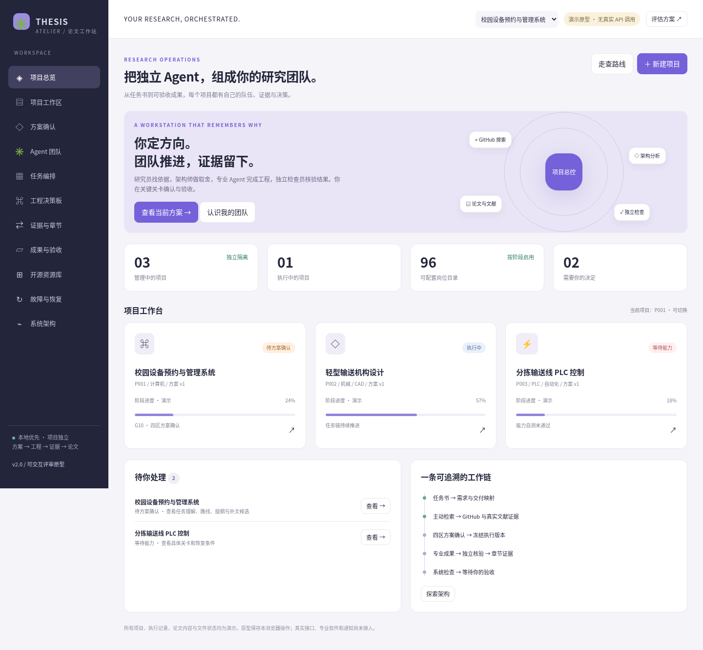

# 毕设论文工作站 · 方案与可点击原型

根据用户提供的八份资料设计，重点是多 Agent 的招募、分工、讨论、任务编排、工程决策、证据交接和失败恢复。

## 下载与查看

**[下载离线交付 ZIP](downloads/thesis-workstation-v2.0.zip)**：在 GitHub 文件页点击 **Download raw file** 下载；解压后打开 **开始评审.html**。也可以在仓库首页点击 **Code → Download ZIP** 下载整个仓库。

HTML 原型需要下载后用浏览器打开，GitHub 文件页只显示 HTML 源码。

| 内容 | 文件 |
| --- | --- |
| 可点击原型：11 个主要页面 | [可点击原型.html](deliverables/v2.0/可点击原型.html) |
| 交互系统架构图：Archify 实际生成 | [架构图.html](deliverables/v2.0/架构图.html) / [PDF](deliverables/v2.0/架构图.pdf) |
| 多 Agent 协作、API 与业务恢复 | [多Agent协作与恢复图.html](deliverables/v2.0/多Agent协作与恢复图.html) |
| 18 页设计与实施方案 | [PDF](deliverables/v2.0/架构设计与方案说明.pdf) / [Word](deliverables/v2.0/架构设计与方案说明.docx) / [Markdown](deliverables/v2.0/架构设计与方案说明.md) |
| 资源清单、复用边界与缺口 | [Excel](deliverables/v2.0/资源复用与缺口清单.xlsx) / [全量CSV](deliverables/v2.0/资源全量索引.csv) |
| 使用与验证说明 | [资源清单与使用说明](deliverables/v2.0/资源清单与使用说明.md) |
| 可继续开发的配置 | [config/](deliverables/v2.0/config/) |

## 资源与编排设计

- 完整保留 **884 条资源索引**，精选 **35 项复用组合**，其中 **34 个 GitHub 项目**有固定提交与公开说明核对记录。
- 提取 **96 个岗位、215 个流程节点、12 套队伍、12 套章节模板、69 类成果和33 个原设计验收场景**。
- 推荐 Paperclip 团队与派发接入，参考 Rovai 长期成员协作；Trellis 用于工作站开发；论文链接入检索、Docling、OfficeCLI与独立审计；Octopus用于有限API切换；CAD、CAE、TIA按能力自测后扩展。
- 方案确认与用户验收是独立关卡。API故障可以有限切换；业务与检查失败保存现场、暂停依赖、通知并等待人工恢复，其他独立项目继续。

## 当前交付状态

本仓库是**方案、可交互原型和开发配置**。示例项目执行、论文内容、产物与通知状态为模拟；真实 Agent、API 网关和专业软件尚未接入。Archify已实际用于本次出图。

原型有41项真实浏览器交互检查通过，另有图表、PDF及配置校验。报告位于 `deliverables/v2.0/research/`。

原始上传资料与私人对话保留在工作区。公开交付版保存八份资料的文件名、SHA-256、版本与提取信息于 [脱敏来源清单](deliverables/v2.0/research/source-manifest.json)，并保留全部整理后的资源索引。需要重新提取原始资料时，使用者应自行提供原附件。第三方README副本与私人附件签名链接不在发布包中。

## 首页预览

