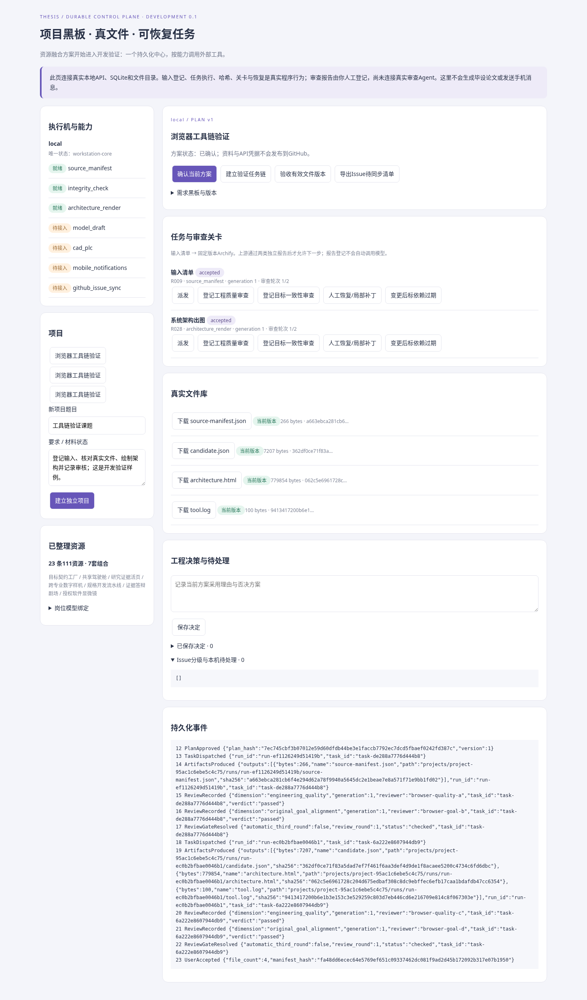

# 毕设论文工作站 · 资源融合与开发验证 v3.0

原8份资料与新增34页《系统开发任务流转与工具链验证》已合并。保留884条资源索引、96岗位、215节点，重点将**111开头的23条记录 / 22主题**编为7套协作蓝图，并开始实现可运行核心。

**[下载完整离线包 v3.0](https://raw.githubusercontent.com/fange5201314/lunwen/main/downloads/thesis-workstation-v3.0.zip)**。解压打开根目录 **开始评审.html**，可点击评估原型和架构；HTML在GitHub文件页显示源码，需要下载后打开。也可使用 **Code → Download ZIP**。

## 现在可以开发什么

**Workstation Core 是唯一业务中心**，负责方案确认、黑板、任务依赖、真实文件、证据版本、检查与验收；Rovai、Paperclip、PI等通过适配器接入。现有 Python/FastAPI/SQLite 本机PoC已跑通：确认方案 → 生成输入清单 → 两类不同身份检查 → 固定Archify出图 → 用户验收下载。状态与真实SHA-256持久化，失败可人工恢复，P0两审后停止自动循环。

**[统一实施方案](docs/开发实施方案-v3.0.md)**说明PDF建议取舍、资源组合、接口、成本和下一批任务。**[运行与验证](docs/运行与验证.md)**提供安装启动步骤；开发任务与验收见 [backlog](config/development-backlog.json)。

```bash
bash scripts/setup.sh
bash scripts/start.sh
```

Linux环境已验证14项控制面测试、8项真实服务浏览器检查及64项融合原型检查。双审计在当前运行界面由人登记；模型接缝用HTTP桩测试。远程笔记本、真实Agent宿主/模型、论文链、GitHub Issue同步、手机通知与Windows专业工具是后续开发范围，详见实施方案。



## 设计交付与资源证据

| 内容 | 文件 |
| --- | --- |
| 7套可点击资源融合实验室 | [HTML](deliverables/v2.0/资源融合实验室.html) |
| 111资源融合方案、范围与成本 | [PDF](deliverables/v2.0/111重点资源融合方案.pdf) / [Word](deliverables/v2.0/111重点资源融合方案.docx) / [Markdown](deliverables/v2.0/111重点资源融合方案.md) |
| 融合编排、证据变更、恢复三视图 | [互动图](deliverables/v2.0/资源融合编排架构.html) / [PDF](deliverables/v2.0/资源融合编排架构.pdf) / [SVG](deliverables/v2.0/资源融合编排架构.svg) / [Mermaid](deliverables/v2.0/资源融合编排架构.mmd) |
| 当前开发核心与后续接口 | [开发验证架构](deliverables/v2.0/开发验证架构.html) / [PDF](deliverables/v2.0/开发验证架构.pdf) |
| 23条重点资源逐项去向与全部索引 | [111 CSV](deliverables/v2.0/111重点资源融合清单.csv) / [Excel](deliverables/v2.0/资源复用与缺口清单.xlsx) |
| 14个补充仓库、12条核心协议 | [适配表](deliverables/v2.0/111补充开源适配表.csv) / [协议证据](deliverables/v2.0/111资源协议复用证据.md) |
| 完整12页工作站原型 | [HTML](deliverables/v2.0/可点击原型.html) |
| 完整设计、API依赖与缺失信息 | [方案PDF](deliverables/v2.0/架构设计与方案说明.pdf) / [资源说明](deliverables/v2.0/资源清单与使用说明.md) |
| 蓝图、门禁、契约与验证报告 | [配置](deliverables/v2.0/config/) / [报告](deliverables/v2.0/research/) |

融合覆盖目标工厂、共享驾驶舱、科研证据活页、跨专业数字样机、规格开发流水线、答辩叙事与授权软件研究。23条重点来源均保留去向：16条设计采用、4条待补证候选、3条索引保留；没有把原帖标题或固定源码核对当成已完成运行集成。

私人原始附件不发布；公开版保留整理结果和脱敏来源SHA清单。[v2.0原离线包](downloads/thesis-workstation-v2.0.zip)保留供对照。当前v3.0包含设计与源码，应用安装仍需联网取得校验后的依赖。
